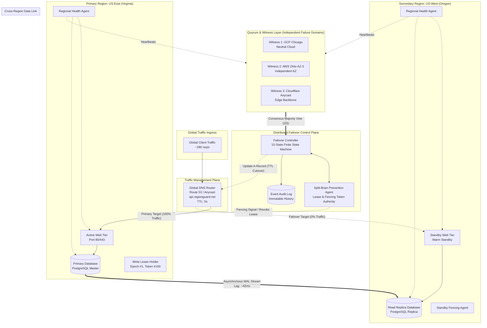

# RegionGuard Architecture Documentation
## PS No. 23: Multi-Region Active-Passive Failover Controller

---

## 1. System Overview

**RegionGuard** is a production-grade virtual lab designed to model, test, and demonstrate distributed consensus, automated regional disaster recovery, and split-brain prevention for mission-critical cloud applications.

In modern cloud computing, applications must survive unexpected regional catastrophes (power grid failures, undersea fiber cuts, hypervisor crashes) without subjecting databases to silent data corruption caused by simultaneous writes across partitioned regions.

RegionGuard implements an **Active-Passive Multi-Region Architecture** backed by an **Automated Quorum-Based Health Monitor**, **DNS Traffic Routers (Route 53 / Google Cloud DNS)**, **Cross-Region Database Replicas**, and a **Split-Brain Prevention Agent**.

---

## 2. Core Safety Invariants

The distributed failover engine is anchored by strict distributed systems correctness invariants:

1. **The Single-Writer Invariant:**
   $$\text{Active Writers} \in \{0, 1\} \quad (\text{NEVER } 2)$$
   At any given millisecond, at most one cloud region possesses write authorization to the cluster.

2. **Fencing and Stale Leader Rejection:**
   Before a replica in Region B is promoted to primary, Region A must be explicitly fenced or its write lease guaranteed to have expired. Any subsequent writes from Region A are discarded with error `STALE_LEADER_WRITE_REJECTED`.

3. **Monotonic Leadership Epochs:**
   Leadership promotions strictly increment a cluster-wide monotonically increasing integer:
   $$\text{Epoch}_{t+1} > \text{Epoch}_t$$
   Every database mutation is tagged with the issuing leader's epoch. Stale epoch submissions are rejected at the storage layer.

4. **Fail-Closed Quorum Safety:**
   If quorum witnesses cannot achieve a strict majority ($\ge 2 \text{ of } 3$ votes) or if the cluster is partitioned into isolated minorities, the controller enters `DEGRADED_NO_QUORUM` and **fails closed**, refusing to promote an unauthorized writer.

---

## 3. High-Level Architecture Diagram

---

## 4. Component Breakdown

### 4.1 Global DNS / Route 53 / Cloud DNS Simulator
- **Role:** Directs global client requests to the active region ingress.
- **Cache Modeling:** Simulates real-world recursive resolver caching. Even after the DNS A-record is updated to Region B, client traffic migrates gradually as the configured TTL (Time-To-Live) countdown expires.
- **Provider Adapters:** Includes a pluggable adapter interface supporting simulated Anycast DNS, AWS Route 53 scaffold, and Google Cloud DNS scaffold.

### 4.2 Cross-Region Database Replication Engine
- **Role:** Streams database mutations from the active writer to the standby read replica.
- **Asynchronous Lag Pipeline:** Models realistic WAN transmission latency (base ~42ms). Injected network congestion or high load increases lag and replication backlog queue.
- **Consistency vs Availability Trade-Off Policies:**
  - **Safety-First Policy:** Refuses to promote a replica if un-replicated transactions exist in the pipeline, preventing any data loss.
  - **Availability-First Policy:** Prioritizes immediate restoration of write uptime, explicitly calculating and logging the transaction loss window.

### 4.3 Automated Quorum-Based Health Monitor
- **Role:** Detects outages without false-positive panic triggers.
- **Consecutive Probes:** Requires 3 consecutive missed health probes before declaring a region suspected or failed (anti-hysteresis/anti-flapping).
- **Independent Witnesses:** 3 simulated witness nodes deployed in neutral regions. Requires a 2/3 majority to authorize state transitions.
- **Failure Discrimination:** Distinguishes between application crash, database crash, witness isolation, and cross-region WAN network partition.

### 4.4 Split-Brain Prevention Agent
- **Role:** Coordinates write leases, fencing tokens, and epoch monotonicity.
- **Time-Bounded Write Leases:** The active leader must renew its lease with majority witness confirmation every cycle. If isolated, the lease safely expires.
- **Pre-Promotion Fencing:** Strictly fences the old leader before promoting the replica.
- **Stale Write Rejection:** Inspects all mutation requests for fencing status, lease validity, and epoch freshness.
